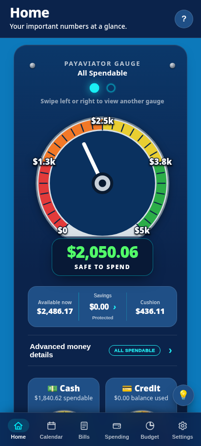
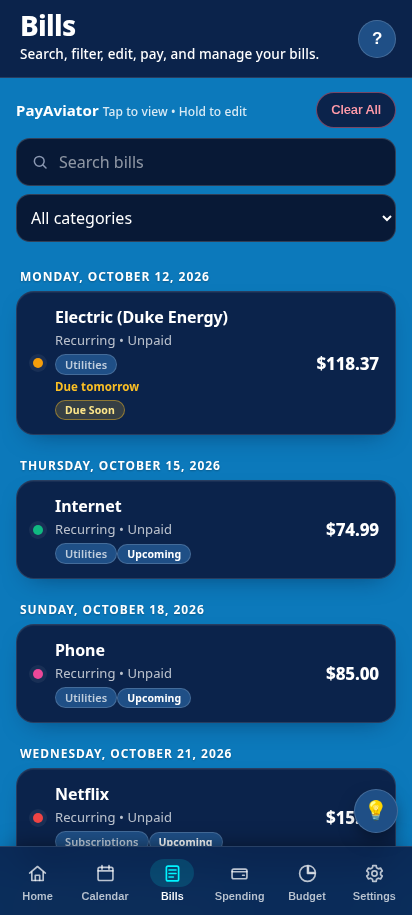

# PayAviator

PayAviator is a local-first Android app for tracking bills, income and spending. It shows how much is safe to spend right now. Your budget data stays on your phone. Bank linking through Plaid is optional and read-only.

<p>
  
  
</p>

## Features

- **Bills:** recurring and one-time bills, a calendar, due-soon status, partial payments and reminders.
- **Income:** hourly (logged hours × wage) or salary, with weekly, biweekly, semi-monthly or monthly paychecks.
- **Spending and budget:** spending and refunds, categories, monthly limits, savings goals and a monthly snapshot.
- **Safe to Spend gauge:** your available balance minus the cushion you choose to protect, plus Cash and Credit gauges.
- **Payoff Planner:** snowball plan with extra payments, payoff date, interest and credit-utilization preview.
- **Bank linking (optional, Android):** read-only balances and transactions through the PayAviator backend and Plaid.
- **Privacy and security:** optional app lock using the phone's own PIN or fingerprint, your own backup and restore, no ads or analytics.

## Repository layout

| Path | What it is |
|---|---|
| `index.html`, `payaviator.css`, `manifest.webmanifest`, `sw.js`, `payaviator-v126-*.png` | The app (single-page web app, also used as a PWA) |
| `app/` | Android wrapper (WebView, native bank bridge, notifications, app lock) |
| `VERSION.txt`, `ANDROID_VERSION_CODE.txt` | Version and Android versionCode floor |
| `tools/` | Build checks: `verify-foundation.py`, `verify-apk-assets.py` |
| `.github/workflows/` | CI builds |
| `docs/` | Update guide, versioning, security notes, store and privacy drafts |
| [`CHANGELOG.md`](CHANGELOG.md) | Release history |

The root web files are the source of truth. Gradle copies them into the APK at build time (`syncPayAviatorWebAssets`).

## Building

**Locally** (JDK 17, Gradle 8.11.1, Android SDK platform 36):

```bash
python3 tools/verify-foundation.py
gradle :app:assembleDebug                       # unsigned debug APK

export PAYAVIATOR_KEYSTORE_FILE=/path/to/payaviator-release.jks
export PAYAVIATOR_KEYSTORE_PASSWORD=...          # also used as the key password; key alias "payaviator"
gradle :app:assembleRelease :app:bundleRelease  # signed APK + Play Store AAB
python3 tools/verify-apk-assets.py app/build/outputs/apk/release/app-release.apk
```

**On GitHub Actions:**
- **Build PayAviator Release** (`build-payaviator.yml`) runs on every push to `main`, or manually. It produces artifact `PayAviator-<version>` containing the signed APK and AAB.
- **PayAviator Signed Update APK** (`payaviator-signed-update.yml`) is manual and builds the APK only.

Install APKs from one workflow consistently, because each workflow keeps its own run counter.

### Signing secrets

Under **Settings → Secrets and variables → Actions**:

- `PAYAVIATOR_KEYSTORE_HEX`: the current PayAviator release keystore, hex-encoded
- `PAYAVIATOR_KEYSTORE_PASSWORD`: its password

Always sign with the current PayAviator release key, which was introduced in 3.9.6 (CN=PayAviator, alias `payaviator`). Android only updates an installed app when the new APK has the same signature, so don't generate or swap in a different key. Any key alias works. See [SECURITY.md](SECURITY.md) and [docs/UPDATE_WITHOUT_UNINSTALL.md](docs/UPDATE_WITHOUT_UNINSTALL.md).

## Versioning

- `VERSION.txt` holds the display version, and `BUNDLED_VERSION` in `index.html` must match it. `tools/verify-foundation.py` checks this.
- CI sets the Android versionCode to `400000 + run number`, never below `ANDROID_VERSION_CODE.txt`.
- Details: [docs/VERSIONING.md](docs/VERSIONING.md).

## More

- [CHANGELOG.md](CHANGELOG.md)
- [docs/UPDATE_WITHOUT_UNINSTALL.md](docs/UPDATE_WITHOUT_UNINSTALL.md): installing an update over the existing app
- [docs/VERSIONING.md](docs/VERSIONING.md)
- [docs/SECURITY-HARDENING-9.8.9.md](docs/SECURITY-HARDENING-9.8.9.md)
- [docs/CONNECTED_ACCOUNTS_PLAN.md](docs/CONNECTED_ACCOUNTS_PLAN.md)
- [docs/FIREBASE_SIGNIN.md](docs/FIREBASE_SIGNIN.md): sign-in for bank features and the backend token contract
- [docs/PRIVACY_POLICY_DRAFT.md](docs/PRIVACY_POLICY_DRAFT.md), [docs/PLAY_STORE_LISTING_DRAFT.md](docs/PLAY_STORE_LISTING_DRAFT.md)

### Banking persistence (3.10.0)
Deploy backend 3.1.8 before connecting again and set a working PostgreSQL `DATABASE_URL` reference in Railway. No Plaid or database secrets belong in this ZIP.
